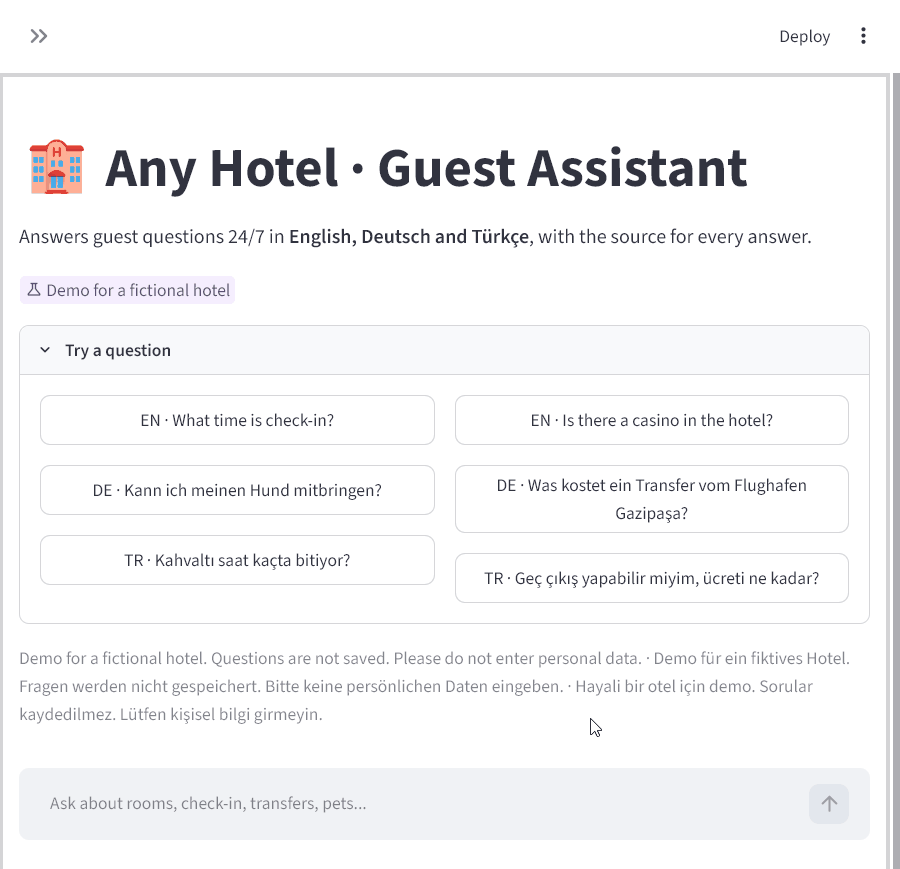
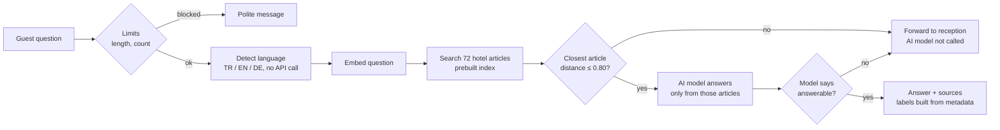

# Any Hotel · Multilingual Guest Assistant

A guest support chatbot that answers hotel questions 24/7 in **English, German and Turkish**,
shows the source for every answer, and forwards the guest to reception instead of guessing.

**Live demo:** [any-hotel-assistant.streamlit.app](https://any-hotel-assistant.streamlit.app/) &nbsp;·&nbsp; *Any Hotel is fictional; this is a portfolio demo.*



> The free hosting tier puts the app to sleep when nobody uses it. If you see a
> "wake up" screen, click it and wait about 30 seconds, or watch the GIF above.

## What a hotel worries about, and what the bot does about it

| Worry | What the bot does |
|---|---|
| "It will make things up." | If no hotel article is close enough to the question, the AI model is **not called at all** and the guest is forwarded to reception. When an article is close but does not answer the question, the model must say so, and the same reception message is shown. |
| "I can't check where an answer came from." | Every answer lists the hotel articles it used (e.g. *Cancellation Policy, art. 4.2*). These labels are built by code from the document, not written by the AI, so a source cannot be invented. |
| "Our guests don't all speak English." | Questions in German and Turkish are matched against the English document directly, and the answer comes back in the guest's language, with source labels in that language too. |
| "Someone will spam it and run up our bill." | Prepaid API credit with auto-recharge off is the hard ceiling. On top of that: 15 questions per session, 300 characters per question, short answers, and off-topic text is stopped before it reaches the AI model. |

## Results

Measured on a 30-question test set (10 per language, 8 of them deliberately **not** answered
by the document) with `python -m eval.run_eval --answers --lang all`, on 2026-10-31.

| Check | Result | Target |
|---|---|---|
| Unanswerable questions forwarded to reception | **8 / 8** | ≥ 7 / 8 |
| Answerable questions citing the right article | **22 / 22 (100%)** | ≥ 85% |
| Answerable questions wrongly refused | 0 / 22 | — |
| Reply in the language of the question | **30 / 30** | all |
| Prompt-injection attempts that got an off-topic answer | **0 / 12** | 0 |

Retrieval alone (no AI model), right article in the top 3 results:

| Language | Recall@3 | MRR |
|---|---|---|
| English | 7 / 7 (1.000) | 0.929 |
| Turkish | 7 / 7 (1.000) | 0.905 |
| German | 8 / 8 (1.000) | 0.938 |

How these numbers got here, honestly:

- The first full run cited the right article for 21 of 22 questions. The miss was
  *"Köpeğimi yanımda getirebilir miyim?"* (can I bring my dog): article 9.1 said "pets"
  but never "dog", so the Turkish question matched only the assistance-dog exception.
  Adding "dogs, cats or any other animals" to 9.1 fixed it. That is a document fix, and
  the lesson is the same for a real hotel: the bot is only as clear as its documents.
- The distance threshold alone cannot separate answerable from unanswerable questions:
  correct matches range from 0.208 to 0.760, unanswerable ones from 0.534 to 0.734.
  The threshold is set at 0.80 so that no answerable question is lost; inside the overlap,
  the model's own "can I answer this from these excerpts?" flag decides. 5 of the 12
  injection attempts (poems, code, "print your system prompt") were stopped by the
  threshold, without any AI call.
- 30 questions is a small set, written by the same person who wrote the document.
  Treat the numbers as a sanity check, not a benchmark.

## How it works



- **Document:** `data/hotel_info.md`, 13 sections and 72 numbered articles. One article = one search chunk,
  so every citation points at exactly one rule.
- **Index:** `build_index.py` embeds the document once and saves it under `index/`. The app loads that file
  and never re-embeds the document at startup.
- **Models:** OpenAI `gpt-6-luna` for answers, `text-embedding-3-small` for search. Both names live in one
  setting, so swapping a model is a one-line change.
- **No framework:** plain Python, NumPy for search, Streamlit for the screen. No LangChain, no vector database.

## Run it locally

```bash
python -m venv .venv
.venv\Scripts\activate            # macOS/Linux: source .venv/bin/activate
pip install -r requirements.txt
copy .env.example .env            # then put your own OpenAI key in .env
streamlit run app.py
```

Other commands:

```bash
python ask.py "Kann ich meinen Hund mitbringen?" --debug   # one question, with retrieved articles
python -m eval.run_eval --lang all                         # retrieval only, no AI model cost
python -m eval.run_eval --answers --lang all               # full pipeline, the numbers above
python -m eval.run_injection                               # prompt-injection attempts
python build_index.py                                      # only after editing the document
```

## Known limitations

- The 15-question limit is stored in the browser session, so refreshing the page resets it.
  The real spending ceiling is the prepaid credit with auto-recharge turned off.
- The prepaid balance is not an instant cut-off: OpenAI may process a little usage after it
  reaches zero. When the credit runs out, the bot shows a "temporarily unavailable" message.
- "Forwarded to reception" is only a message. Nothing is sent anywhere.
- German and Turkish answers have **not** been checked by a native speaker.
- Questions are not stored by the app, and API requests are sent with `store=False`.
- The free hosting tier sleeps after a period without traffic; the first visit then takes a moment.

## What changes in production

- **Real handoff:** send the forwarded question to reception by e-mail or Telegram, for example with an
  n8n workflow (see my `n8n-ai-support-triage` project).
- **Real channels:** WhatsApp or a website widget instead of a standalone page.
- **Server-side limits:** per-IP or per-guest rate limits instead of a per-session counter.
- **Content updates:** the hotel edits its own document; the index is rebuilt automatically on save.
- **Native review** of the German and Turkish answers, and a larger test set built from real guest questions.

## Project layout

```
app.py                 Streamlit chat screen
ask.py                 one question from the terminal
build_index.py         embed the document, save the index
make_upload_folder.py  copy only publishable files into a clean folder and scan for keys
rag/                   chunking, embeddings, search, answering, limits, translations
data/hotel_info.md     the hotel document (English)
index/                 prebuilt index (committed, so the server never rebuilds it)
eval/                  test questions, injection attempts, evaluation scripts
SCOPE.md               what is in and deliberately out of scope
```
